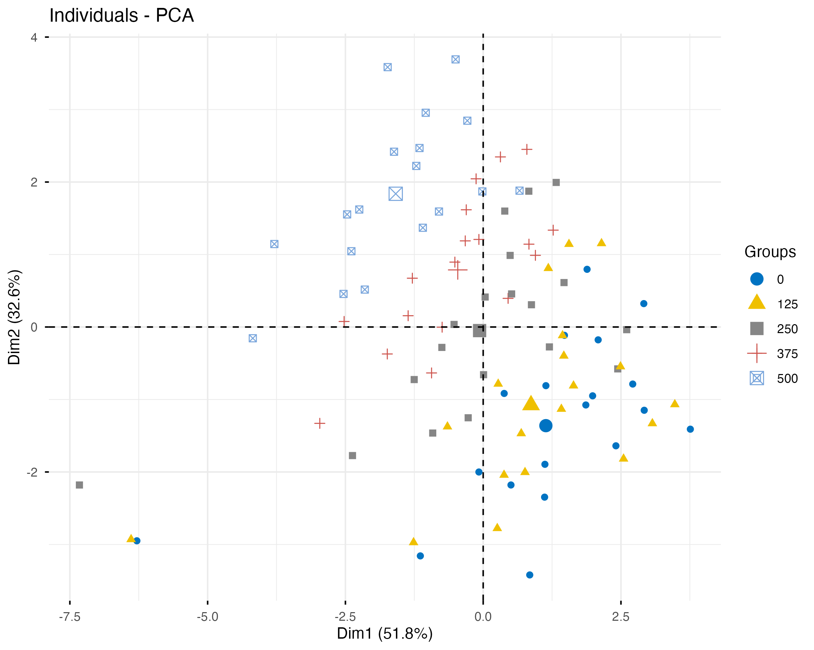

## 1. Configuración del entorno de trabajo

```{r}
# Carga de la configuración utilizada en clase
source("https://inkaverse.com/setup.r")

# Paquetes para importación de datos y análisis multivariado
library(googlesheets4)
library(factoextra)
```

## 2. Importación de datos

```{r}
# Enlace de la base de datos original
url <- "https://docs.google.com/spreadsheets/d/1taQNaBUujMLd3hBDbod2XphWdCJqVW3x6BM1LrPpfq8/edit"

# Identificación de las hojas del archivo
sheet_names(url)

# Importación exclusiva de la hoja STable3
dtx <- read_sheet(url, sheet = "STable3")

# Revisión de la estructura de los datos
str(dtx)
```

## 3. Preparación de variables

```{r}
# Conversión de accesiones y concentraciones de NaCl en factores
dtx <- dtx %>%
  mutate(
    accessions = as.factor(accessions),
    nacl = as.factor(nacl)
  )

# Verificación de los tipos de variables
str(dtx)
```

## 4. Identificación de datos faltantes

```{r}
# Conteo de valores faltantes por variable
colSums(is.na(dtx))

# Identificación de observaciones con datos faltantes
dtx[!complete.cases(dtx), ]
```

## 5. Preparación de datos para el PCA

```{r}
# Creación de una base con observaciones completas
# Se conserva la base original dtx
dtx_pca <- dtx %>%
  tidyr::drop_na(grp, mgt, gsp, syn)

# Verificación de las dimensiones de la base preparada
dim(dtx_pca)
```

## 6. Análisis de componentes principales (PCA)

```{r}
# PCA con variables cuantitativas estandarizadas
# accessions y nacl se incorporan como variables suplementarias
mv <- dtx_pca %>%
  PCA(
    scale.unit = TRUE,
    graph = FALSE,
    quali.sup = c(1, 2)
  )
```

## 7. Visualización de variables del PCA

```{r}
# Gráfico de variables del PCA

var <- mv %>%
  plot.PCA(
    choix = "var",
    cex = 0.7
  )

var
```

## 8. Calidad de representación de las variables (cos²)

```{r}
# Gráfico de variables según su calidad de representación (cos²)

cos <- mv %>%
  fviz_pca_var(
    col.var = "cos2",
    gradient.cols = inti:::paleta(),
    repel = TRUE,
    labelsize = 2
  )

cos
```

## 9. Visualización de individuos del PCA

```{r}
# Gráfico de individuos del PCA

ind <- mv %>%
  plot.PCA(
    choix = "ind",
    cex = 0.7,
    label = "ind",
    invisible = "quali",
    col.hab = inti:::paleta(),
    habillage = "none"
  )

ind
```

## 10. Agrupamiento jerárquico sobre componentes principales (HCPC)

```{r}
# Agrupamiento jerárquico a partir de los resultados del PCA

cls <- mv %>%
  HCPC(
    nb.clust = -1,
    graph = FALSE
  )
```

## 11. Visualización de grupos del HCPC

```{r}
# Mapa de agrupamiento jerárquico sobre componentes principales

plot.HCPC(
  cls,
  choice = "map",
  draw.tree = FALSE
)
```

## 12. Caracterización de los grupos del HCPC

```{r}
# Número de observaciones por grupo

table(cls$data.clust$clust)
```

## 13. Caracterización cuantitativa de los grupos HCPC

```{r}
# Variables cuantitativas que caracterizan los grupos

cls$desc.var$quanti %>%
  kable(caption = "Variables cuantitativas por grupo")
```

## 14. Caracterización cualitativa de los grupos HCPC

```{r}
# Caracterización de grupos según accesiones y concentraciones de NaCl

cls$desc.var$category %>%
  kable(caption = "Variables cualitativas por grupo")
```

## 15. Visualización de individuos según concentración de NaCl

```{r}
#| fig-width: 9
#| fig-height: 6
# Gráfico de individuos diferenciados por concentración de NaCl

ind_nacl <- fviz_pca_ind(
  mv,
  habillage = dtx_pca$nacl,
  label = "none",
  addEllipses = FALSE,
  palette = "jco",
  pointsize = 2
)

ind_nacl
```

## 16. Exportación del PCA según concentración de NaCl

```{r}
# Creación de la carpeta para guardar las figuras
dir.create("manuscript/figuras",
           recursive = TRUE,
           showWarnings = FALSE)

# Exportación del PCA según concentración de NaCl
ggsave(
  filename = "manuscript/figuras/pca_nacl.png",
  plot = ind_nacl,
  width = 20,
  height = 16,
  units = "cm",
  dpi = 300
)
```

## 17. Verificación de la figura exportada

```{r}
# Verificación y visualización de la figura guardada

file.exists("manuscript/figuras/pca_nacl.png")


```


